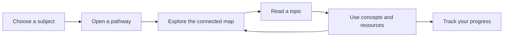
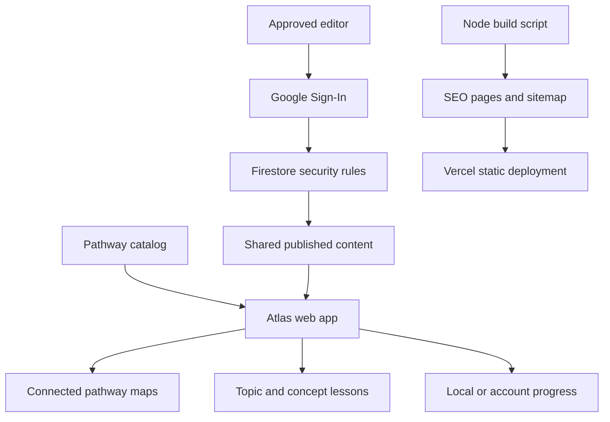

<p align="center">
  
</p>

<h1 align="center">YFLB Atlas</h1>

<p align="center">
  A bilingual learning atlas for exploring a subject, following connected ideas, and building practical knowledge one step at a time.
</p>

<p align="center">
  <a href="https://yflb-atlas.vercel.app/"></a>
  
  
  
</p>

<p align="center"><a href="#english">English</a> · <a href="#العربية">العربية</a></p>

## English

### Explore with direction, learn at your own pace

YFLB Atlas turns broad fields into connected, searchable learning pathways. Each pathway is a visual map of main ideas and smaller topics, with explanations, learning resources, and simple progress tracking. Start with any topic, follow the connections that interest you, and return whenever you are ready.

The catalog currently includes **517 pathways** across **14 subject families**, with **46,104 learning checkpoints**. The pathways are self-paced guides: they do not award degrees, academic credit, licenses, or professional certifications.

### What you can do

| Explore | Learn | Keep your place |
| --- | --- | --- |
| Browse by subject or search across pathways and topics. | Open a checkpoint for its overview, related concepts, and learning resources. | Mark any checkpoint as **Learning**, **Done**, or **Skip**. |
| Follow connected maps to see how ideas relate. | Read in English or Arabic, with right-to-left layout for Arabic. | Save pathways and track progress on this device or across signed-in devices. |
| Use spelling suggestions when a search is close to a result. | View long explanations with a contents panel and Markdown formatting. | Reopen completed or skipped checkpoints whenever you like. |

All learning checkpoints are open from the start. Connections suggest how concepts relate; they do not lock content or require a fixed sequence.

### Subject families

Business and management, accounting, finance, economics, marketing, people and organizations, communication, psychology, operations, analysis, information systems, data and analytics, applied fields, and professional foundations.

### A simple learning loop



### Reading and Markdown

Topic and concept explanations support headings, bold and italic text, strikethrough, ordered and unordered lists, task lists, links, quotes, inline and fenced code, horizontal rules, and tables. Editors include a live preview and a formatting example. On phones, tables reflow into labeled rows so the information fits the screen without horizontal scrolling.

```markdown
## Revenue and costs

Revenue is the value earned from providing goods or services.

| Concept | What to understand |
| --- | --- |
| Revenue | Where income comes from |
| Cost | What the organization spends |

> Compare both over the same period before drawing conclusions.
```

### Languages, accessibility, and display

- Switch between English and Arabic; the selected language is saved on the device.
- Arabic pages use right-to-left direction and Arabic-friendly typography.
- Light and dark themes preserve the Atlas color system.
- Pathways, lessons, saved items, and account pages adapt to desktop and mobile screens.
- Lesson pages provide a table of contents, reading layout, completion control, and previous/next navigation.
- Search, focus states, and touch controls are designed for keyboard and mobile use.

### Accounts, publishing, and privacy

- Anyone can browse published pathways and use Google Sign-In to keep personal learning progress across devices.
- Signed-out progress stays in the current browser. Signed-in progress is stored per account and is only readable by its owner.
- The content editor is available to the approved, verified editor accounts. Firestore rules enforce publishing permissions on the backend as well as in the interface.
- Published pathway content is readable by all visitors. Personal learning data is private to the signed-in account.

### How the app is organized



### Technology

- **Frontend:** HTML, CSS, and modern JavaScript modules.
- **Catalog:** bilingual source data and pathway expansion files in `src/`.
- **Authentication and shared content:** Firebase Authentication and Cloud Firestore.
- **Build and search metadata:** Node.js 20 or newer; the build generates static route pages, metadata, and a sitemap.
- **Hosting:** Vercel, configured in `vercel.json`.

The project has no npm package dependencies. Firebase's browser SDK is loaded as an ES module from Google's CDN.

### Run locally

1. Install **Node.js 20+** and Python 3.
2. From the repository root, build the static site:

   ```bash
   npm run build
   ```

3. Serve the generated `dist/` folder:

   ```bash
   python -m http.server 8000 --directory dist
   ```

4. Open [http://localhost:8000](http://localhost:8000).

The build creates the generated site in `dist/`. No `npm install` step is needed. Google Sign-In on another host requires that host to be configured in Firebase Authentication.

### Build and deployment

Vercel uses the repository's `vercel.json` settings:

| Setting | Value |
| --- | --- |
| Build command | `npm run build` |
| Output directory | `dist` |
| Client routes | Rewritten to the Atlas app |
| Firebase Auth helper | Proxied to the Firebase project |

With the GitHub repository connected to Vercel, pushing to the production branch triggers a deployment. The build generates page-specific titles, descriptions, social metadata, canonical URLs, and `sitemap.xml` for the catalog.

### Project structure

```text
.
├── assets/
│   └── logos/                  # Original supplied YFLB logo files
├── scripts/
│   └── build.mjs               # Generates static routes and SEO metadata
├── src/
│   ├── app.js                  # Routing, catalog UI, learning, and progress
│   ├── content-store.js        # Firebase auth, publishing, and account sync
│   ├── data.js                 # UI copy and bilingual starter catalog
│   ├── firebase-config.js      # Public Firebase web configuration
│   ├── markdown-renderer.js    # Safe Markdown-to-HTML rendering
│   ├── roadmap-library.js      # Subject families and pathway catalog
│   ├── roadmap-expansion.js    # Specialist pathway coverage
│   ├── roadmap-depth.js        # Deeper topics and pathway relationships
│   ├── styles.css              # Responsive interface and components
│   └── tokens.css              # Shared color, type, spacing, and theme tokens
├── firebase.json               # Firebase project configuration
├── firestore.rules             # Content publishing and progress access rules
├── vercel.json                 # Build, rewrite, and auth proxy settings
└── README.md
```

### Contributing

1. Keep user-facing text available in both English and Arabic.
2. Preserve the supplied YFLB logo assets and shared design tokens.
3. Keep learning progress private to its owner and content publishing restricted by Firestore rules.
4. Run `npm run build` before submitting changes to confirm the generated site is valid.
5. For content changes, include concise explanations and reliable learning sources where appropriate.

### Learning scope

Atlas provides self-paced educational guidance. It is not a university program or an official equivalency for a degree, academic credit, professional license, or employer credential. Requirements and recognition depend on the institution and jurisdiction.

---

## العربية

**YFLB Atlas** منصة ثنائية اللغة لاستكشاف المجالات عبر مسارات مترابطة. كل مسار خريطة قابلة للبحث توضّح الموضوعات الرئيسية والمفاهيم المرتبطة بها، وتوفر شروحات ومصادر تعليمية ومتابعة للتقدم. يمكنك البدء من أي موضوع؛ لا توجد نقاط مقفولة أو ترتيب إلزامي.

يضم الدليل حاليًا **517 مسارًا** ضمن **14 مجموعة معرفية**، تشمل الأعمال والإدارة والمحاسبة والتمويل والاقتصاد والتسويق وإدارة الأفراد والتواصل وعلم النفس والعمليات والتحليل ونظم المعلومات والبيانات والمجالات التطبيقية والمهارات المهنية.

### تجربة التعلم

- استكشف المسارات أو ابحث عن مجال وموضوع، مع اقتراح تصحيح عند وجود خطأ إملائي قريب.
- افتح أي نقطة لقراءة شرحها ومفاهيمها الفرعية والوصول إلى مصادر للتعلم.
- سجّل كل نقطة كـ **أتعلّم** أو **أُنجز** أو **تخطٍّ**، وغيّر حالتها في أي وقت.
- استخدم الواجهة بالعربية أو الإنجليزية؛ اتجاه العربية من اليمين إلى اليسار.
- احفظ تقدمك في المتصفح، أو اربطه بحسابك لمزامنته بين أجهزتك.
- يدعم شرح الدروس Markdown، بما فيه العناوين والقوائم والجداول. على الهاتف تتحول صفوف الجدول إلى بطاقات تحمل اسم كل عمود.

### تشغيل المشروع

يتطلب البناء Node.js 20 أو أحدث. من مجلد المشروع شغّل:

```bash
npm run build
python -m http.server 8000 --directory dist
```

ثم افتح [http://localhost:8000](http://localhost:8000). لا يحتاج المشروع إلى تثبيت حزم npm. تسجيل الدخول عبر Google على نطاق محلي أو نطاق جديد يتطلب السماح بالنطاق من إعدادات Firebase Authentication.

### الأمان والخصوصية

المحتوى المنشور متاح للقراءة للجميع. يقتصر النشر على حسابات المحررين الموثقة، وتفرض قواعد Firestore ذلك من جهة الخادم. تقدم التعلم المحفوظ في Firestore خاص بصاحبه، بينما يظل تقدم الزائر غير المسجل على جهازه.

### تنبيه أكاديمي

المسارات أدلة تعليم ذاتي، ولا تمثل برنامجًا جامعيًا معتمدًا أو معادلة لساعات أكاديمية أو ترخيصًا أو شهادة مهنية. تختلف شروط الاعتراف بحسب المؤسسة والجهة التنظيمية والدولة.
